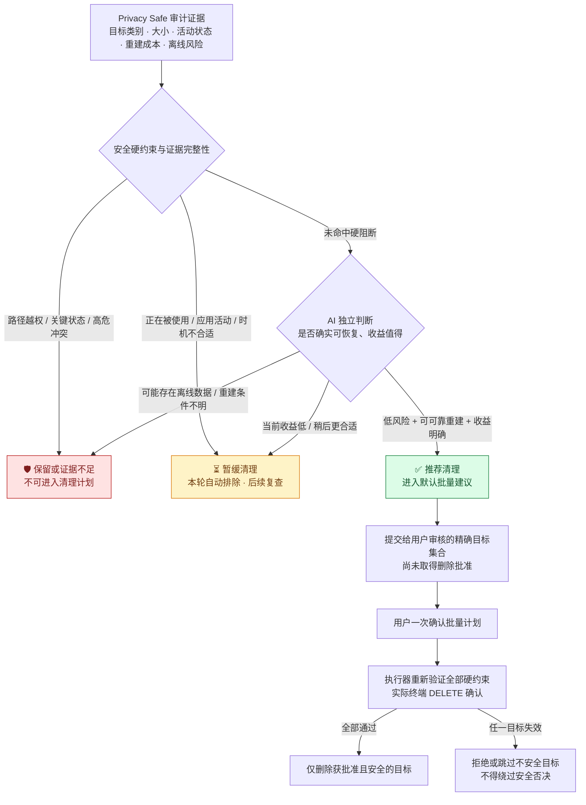

# MacLean · AI 清理决策三态图（研究基线 v1.0）

> **FROZEN RESEARCH BASELINE** · 2026-10-17 · 所在分支：`research/ai-decision-batch-ux-v1`
>
> 这是产品设计合同，不是当前执行器已实现的全部功能。修改任何决策状态、守卫优先级或默认行为时，必须显式提交设计变更记录并更新本基线版本；不得在代码实现中悄悄改变。

## 图 1：AI 最终应形成的清理决策

## 三态语义（不可漂移）

| 最终 AI 判定 | 条件 | 批量计划处理 |
|---|---|---|
| **推荐清理** | 证据足够、可可靠重建、影响小、收益值得，且未命中执行器硬阻断 | **可以**纳入默认推荐清单；不意味着已批准 |
| **暂缓清理** | APP/工作进程正在使用、正在更新、未来短期需要、暂时风险大于收益 | **本轮自动排除**；状态改变后重新审计 |
| **保留或证据不足** | 凭据、个人数据、工作状态，或无法证明重建可行；包括离线优先应用的可疑缓存 | **不进入删除计划**；禁止用文件名 `Cache` 推断可删除 |

## 外部机器状态不是 AI 的决定

- `MEASURED`：测得空间使用量，仅代表观测成功。
- `REVIEW`：没有被现有安全校验否决，不代表“应该删除”。
- `ACTIVE`：进程活动信号，现有执行器保守阻断；不代表目标必定有打开的文件。
- `PROTECTED` / `UNKNOWN`：任何时候都不得被 AI 直接改判为执行允许。

**硬否决优先于所有 AI 推荐。** 不得为了提高清理量、追求“傻瓜式”而放宽隐私边界、活跃状态、符号链接、路径身份、Git 仓库数据保护或用户批准条件。

## 特别讨论：飞书 / Chrome CacheStorage

MacLean v1.4 候选将精确的 Service Worker CacheStorage 叶目录加入定向发现。发现并测量 **不等于** 证明内容可以无损重新下载。可能存在离线应用数据、账户状态和临时未同步操作；默认推荐必须 **排除** 证据不足的 Profile 缓存。除非以后有更强的专用应用语义验证，否则不能纳入“闭眼确认”的低风险清理组。

## 验收恒定条件

1. AI 不能把全部 `REVIEW` 自动等同推荐清理。
2. 任意 `ACTIVE`、`PROTECTED`、`UNKNOWN` 项不得偷偷进入一次确认计划。
3. 只向用户提出 **一个经过筛选的批量计划**，不要求用户自行逐目录分类；但用户可以展开准确目标明细。
4. 用户未批准（`user_approved=false`）和 dry-run 永远不得改动真实文件。
5. 计划批准、终端 DELETE 和删除前即时安全重检是相互独立的门槛。
6. 清理收益只显示 **已测分配空间估计**；不承诺 APFS 可用空间一定增加相同数量。
7. 决策、修改和执行均留存本地脱敏、可审计证据，不上传个人目录清单。

**后续修改协议**：提出新 RFC → 明确变更前后的三态含义和安全影响 → 添加反例/负向测试 → 人类批准 → 发布新的 v1.x 设计图。旧版保留供比较。
