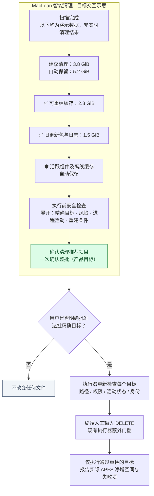

# MacLean · 智能清理目标交互图（研究基线 v1.0）

> **FROZEN RESEARCH BASELINE** · 2026-10-17 · 与 [AI 决策三态图](AI-DECISION-STATES-v1.md) 共同构成长期设计基线。
>
> **此图是未来交互示意，非当前可执行 UI。图中的 3.8 GiB、5.2 GiB、2.3 GiB 和 1.5 GiB 均为原设计示例数字，不是任何真实机器报告。**

## 图 2：MacLean 智能清理 — 目标交互

## 固定的用户界面骨架（与设计图一致）

> ### MacLean 智能清理
> **扫描完成** · 目标交互示意，非实时结果
>
> | 建议清理 | 自动保留 |
> |---:|---:|
> | **3.8 GiB** | **5.2 GiB** |
>
> ✅ 可重建缓存　**2.3 GiB**
>
> ✅ 旧更新包与日志　**1.5 GiB**
>
> 🛡 活跃组件及离线缓存　**自动保留**
>
> **执行前安全检查**：展示将删除的准确目标及重建风险；用户确认后重新检查进程、文件身份与隐私约束。不满足条件的目标不执行。
>
> **[确认清理推荐项目]（设计示意；此 Markdown 不会执行删除）**

## 产品不变量

- **简单，不是隐瞒**：用户面对一份 AI 已审查的推荐清单，而不是几十项专业路径选择题；仍能查看将删除的精确目标。
- **一次批量批准，不是后台自动删除**：只允许事先明确展示的目标进入待执行批次；绝不把目录发现行为当作用户同意。
- **自动排除不确定项**：`ACTIVE`、`PROTECTED`、`UNKNOWN` 和无法证明可重建的个人 Profile CacheStorage 不作为默认候选。
- **真正有条件才执行**：真实执行前对每项重新校验当前进程、路径归属、符号链接、Git/worktree、身份变化、硬性隐私否决。
- **失败时保守**：任何无法证明安全的目标都不删除；不得为了达到预计释放量而扩大扫描或清理范围。
- **清理结果闭环**：计划空间（`du`）≠ 实际 APFS 可用空间增量；要分别展示。
- **恢复和可逆性**：当前执行器执行的是永久删除（并非移动到废纸篓）；不能承诺“一键撤销”。如将来加入可撤销机制，必须单独设计。

## 现状与差距（截至 2026-10-17）

| 体验 | 已实现 | 待研究/实现 |
|---|---|---|
| Privacy Safe 默认审计、三态的原始安全信号 | 是（v1.3.1；v1.4 研发分支扩展缓存 catalog） | AI 三态稳定评测 |
| AI 生成附理由/条件的未批准计划与 dry-run | 是（需 Agent 工作流） | 自动整理为单批高置信度建议 |
| 执行器的路径/进程/TTY 否决 | 是 | 批处理事务边界、逐项跳过与二次校验体验 |
| 交互式一键图形界面 | **否** | 目标设计，不得声称当前已经实现 |
| 实际删除空间反馈 | 代码支持执行前后卷级统计 | 需要真实授权试验与 APFS 结果对照 |

## 防漂移验收案例

- 用户不懂 npm/uv/CacheStorage：系统仍能提交一句话可理解的建议，明确哪些会保留。
- 未批准计划：显示预览，但不删除。
- 用户一次批准后出现新 Codex 进程：对应目标不得删。
- 飞书离线缓存即使很大：证据不足时默认保留。
- AI 误判 `CacheStorage` 为“可下载”：执行器不因此豁免 Profile 路径限制。
- 用户关闭窗口 / 终端不确认：不删除。
- 清理后实际新增容量少于估算：如实报告、不得改写估算基线。

**设计修改流程**：先更新 RFC、案例与图 1 的决策状态，再改变图 2 UI，最后更新代码与验收测试；不得反向为了实现方便而改变设计语义。
