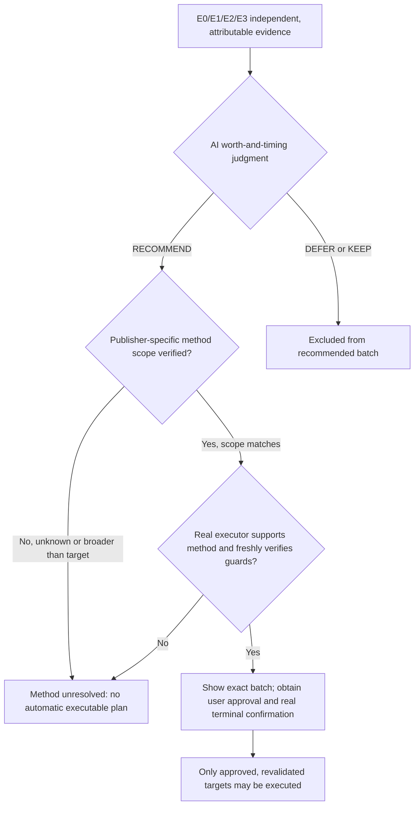

# Decision Engine v0.3 · Evidence Ladder Experimental Results

**2026-10-17 · exploratory research only**  
**Not a released Skill, not a production cleanup recommendation, not a real-user deletion.**

## 1. E1 authoritative source semantics

| Cache owner | Official behavior | Important operational caveat |
|---|---|---|
| **uv** | Cache pruning and cleaning via native CLI. Direct manual deletion not safe according to its documentation. uv enforces locks on cache modifying operations. | `prune` may remove centralized project environments (recreated on demand); `clean` is broader; both may cause redownload/rebuild |
| **Puppeteer** | Browser download, reinstall, plus `@puppeteer/browsers clear` for **all installed browsers**. | A rebuild reference is not proof that the network can fetch that exact build now; `clear` can exceed a single candidate's scope |
| **Playwright** | Browser-version tracking with clients and automatic stale-version garbage collection, plus its separate uninstall options. | A generic command like `NATIVE_CLEAN` is not necessarily equivalent to client-aware GC; browser version mapping must be confirmed |

Source URLs:
- https://docs.astral.sh/uv/concepts/cache/
- https://pptr.dev/guides/installation
- https://pptr.dev/browsers-api
- https://playwright.dev/docs/browsers

## 2. Actual local E2 fixture verification

On the authorized macOS arm64 host, **uv 0.12.5** was used with a fresh, isolated temporary `UV_CACHE_DIR`. The original user cache was not accessed, deleted or rewritten.

| Test | Observed |
|---|---|
| Native `uv cache prune`, isolated, offline | PASS |
| Native `uv cache clean`, isolated, offline | PASS |
| External synthetic sentinel unchanged | PASS |
| Invalid target paths denied | 3/3 |
| Symlink pointing to user HOME refused | PASS |
| `lsof` scoped to our own synthetic child process detected exact open file | PASS |
| Actual user cache deletion | **0** |

**What was not proved:** real package recovery, rebuild timing, network reliability, APFS physical reclaim and absolute proof of no future cache dependency. E2 on an empty/isolated cache is a *command scoping demonstration*, not full application-lifecycle verification.

## 3. Synthetic E0/E1/E2/E3 ladder probe

Nine **hypothetical** cases with no private Mac identifiers or file locations. E3 fields in this experiment are assumed facts in an invented scenario, **not independent sensor output from this user's Mac**.

Both models ran the same case set using existing configured providers; MiniMax requested `reasoning_effort=max`, DeepSeek requested `thinking.enabled`. Single runs; speed differences are not benchmark claims.

| Synthetic case | Machine state | Given level | MiniMax | DeepSeek |
|---|---|---|---|---|
| L01 uv, type/size only | REVIEW | E0 | KEEP | KEEP |
| L02 uv, official doc + disposable method fixture | REVIEW | E2 | KEEP | KEEP |
| L03 uv, all current-use/recovery conditions assumed | REVIEW | E3 hypothetical | **RECOMMEND · NATIVE_PRUNE** | **RECOMMEND · NATIVE_PRUNE** |
| L04 uv, otherwise complete but active | ACTIVE | E3 hypothetical | KEEP | DEFER |
| L05 Puppeteer, install documentation only | REVIEW | E1 | KEEP | KEEP |
| L06 Puppeteer, current-use/recovery assumed | REVIEW | E3 hypothetical | RECOMMEND · NATIVE_CLEAN | RECOMMEND · EXACT_PATH |
| L07 Playwright, still protected | PROTECTED | E3 hypothetical | KEEP | KEEP |
| L08 Playwright, assumed unused client-aware version | REVIEW | E3 hypothetical | RECOMMEND · NATIVE_CLEAN | RECOMMEND · NATIVE_CLEAN |
| L09 Browser Profile CacheStorage, unknown rebuildability | REVIEW | E0 | KEEP | KEEP |

**State outcome:** MiniMax 3 RECOMMEND / 0 DEFER / 6 KEEP; DeepSeek 3 RECOMMEND / 1 DEFER / 5 KEEP; agreement **8/9**. Both withheld recommendations from ACTIVE and PROTECTED cases. This demonstrates **conditional responsiveness to richer hypothetical evidence**, not operational proof or real-machine accuracy. Gold labels were not independently annotated.

**Primary experimental contrast:** both previously gave KEEP to all 12 privacy-minimized real Mac candidates, for which independent E3 evidence was unavailable. Given fictional full E3 conditions, they recommended three candidates. A future experiment must establish whether genuine E3 checks are possible without accessing sensitive user data or disrupting work.

## 4. Crucial new failure mode: recommendation versus method scope

A separate [method auditor](audit_strategy_v03.py) assessed whether a RECOMMEND had a **publisher-scoped, independently tested** cleanup strategy. Both models failed method verification for **2/3 recommendations**:

- **L03 uv:** Both suggested `NATIVE_PRUNE` — the corresponding command was verified **only on a disposable uv fixture**; the decision remains unauthorized for real cache application.
- **L06 Puppeteer:** MiniMax suggested `NATIVE_CLEAN` and DeepSeek `EXACT_PATH`. A publisher `browsers clear` operation exists but is broad (all installed browser builds), and no scoped exact-path delete adapter has been verified. Both withheld from executable planning.
- **L08 Playwright:** Both suggested `NATIVE_CLEAN`, which is not established to be equivalent to Playwright's client-aware stale browser GC; withheld from executable planning.

Neither model attempted to actually delete files; the auditor is read-only. These method findings are not a criticism of the models' state labels by themselves: the experiment deliberately used a too-generic strategy vocabulary.

## 5. Updated architecture boundary (supplement; frozen diagrams unchanged)

A product-friendly single-batch UI can preserve all three independent responsibilities: AI judges value; an **application method adapter** interprets cleanup scope; the original executor gates mutation. This supplements, and does not silently overwrite, the frozen v1.0 philosophy and two diagrams.

## 6. Current shortcomings and next milestone

- **No real E3 sensor yet.** `lsof` detecting an opened disposable file is a positive indicator only; not finding an open handle does not prove a cache will never be needed. Unknown must not become `NO_DEPENDENCY`.
- **No genuine Puppeteer/Playwright E2 fixture test.** Source docs alone establish E1, not scope equivalence.
- **No supported production native adapter.** The `NATIVE_CLEAN` string is too coarse to carry semantics safely across apps.
- **No independent human gold.** A small hand-authored hypothetical scenario set cannot measure real AI correctness.
- **No new real deletion.** All published outcomes are research and bounded synthetic fixtures.

Next implement read-only, **app-specific** version/client dependency mapping; then portable on-disk fixtures for Puppeteer/Playwright (without invoking cache deletion on user data). Differentiate operations as `uv.cache.prune`, `puppeteer.browsers.clear_all`, `playwright.browsers.gc_unused` etc., with explicit target-scope and restoration contracts. Only introduce a real cleanup adapter after negative testing and an RFC against the frozen one-batch UX design.
